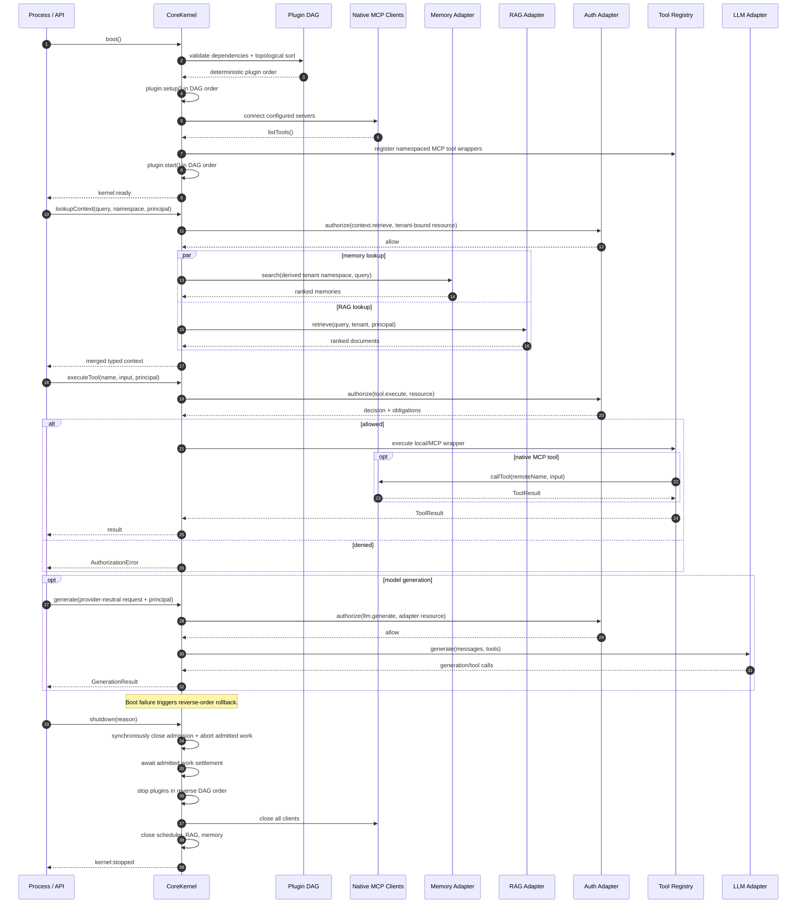

# AgentOS architecture

AgentOS is an LLM-neutral runtime kernel. The kernel owns ordering, lifecycle, authorization boundaries, tool dispatch, native MCP discovery, context retrieval, rollback, and graceful shutdown; vendor-specific behavior remains behind adapters.

## Production folder tree

The starter implements the bold core files now; the remaining tree is the intended production decomposition as the system grows.

```text
agentos/
├── ARCHITECTURE.md
├── package.json
├── tsconfig.json
├── src/
│   ├── CoreKernel.ts
│   ├── contracts.ts
│   ├── index.ts                       # public package surface
│   ├── bootstrap/
│   │   ├── config.ts                  # validated environment/config loading
│   │   ├── container.ts               # adapter and plugin composition root
│   │   └── main.ts                    # process signals and kernel boot
│   ├── adapters/
│   │   ├── llm/                       # OpenAI, Anthropic, Bedrock, local adapters
│   │   ├── embeddings/                # embedding-provider adapters
│   │   ├── memory/                    # Postgres/vector/ephemeral stores
│   │   ├── rag/                       # retriever and reranker adapters
│   │   ├── auth/                      # OPA, Cedar, RBAC adapters
│   │   └── scheduler/                 # durable queue/cron adapters
│   ├── tools/
│   │   ├── registry.ts                # validation and versioned tool catalog
│   │   ├── builtins/                  # first-party tools
│   │   └── middleware/                # audit, timeout, policy, telemetry
│   ├── mcp/
│   │   ├── clientFactory.ts           # official MCP SDK integration
│   │   ├── transports/                # stdio, HTTP and SSE transports
│   │   └── trustPolicy.ts             # allowlists and schema constraints
│   ├── plugins/
│   │   ├── catalog.ts                 # enabled plugin composition
│   │   └── first-party/               # domain plugins
│   ├── observability/
│   │   ├── logger.ts                  # structured logging
│   │   ├── metrics.ts                 # counters, histograms, health
│   │   └── tracing.ts                 # OpenTelemetry spans
│   ├── security/
│   │   ├── secrets.ts                 # secret-provider abstraction
│   │   ├── redaction.ts               # sensitive-data controls
│   │   └── tenancy.ts                 # tenant boundary enforcement
│   └── api/
│       ├── http.ts                    # authenticated ingress
│       ├── schemas.ts                 # external request validation
│       └── errors.ts                  # stable error mapping
├── test/
│   ├── CoreKernel.test.ts
│   ├── contract/                      # adapter conformance suites
│   └── integration/                   # MCP/database/provider tests
├── migrations/                        # persistent adapter schemas
├── config/                            # non-secret environment overlays
├── deploy/
│   ├── docker/
│   ├── kubernetes/
│   └── terraform/
├── scripts/                           # migration and operational scripts
└── .github/workflows/                 # build, test, scan and release
```

## Runtime sequence



## Lifecycle, security, and failure guarantees

1. Plugin names are unique. Every declared dependency must exist. Cycles and invalid MCP configuration fail before plugin or MCP side effects.
2. `setup` and `start` run in deterministic dependency order. If `setup` partially fails, that plugin is cleaned with `rollback` (or `stop`) before previously initialized plugins roll back in reverse order.
3. The kernel is single-use: after shutdown or failed boot it remains `stopped`, and a later `boot()` rejects. Shutdown is idempotent.
4. Calling `shutdown()` closes admission synchronously and aborts every admitted operation. Teardown waits for those operations to settle before stopping plugins or closing MCP, scheduler, RAG, or memory adapters. Adapters receive the combined caller/kernel abort signal and must honor it promptly. Initiating shutdown from inside an admitted operation is rejected to prevent self-deadlock.
5. Authorization is fail-closed for `tool.execute`, `context.retrieve`, `llm.generate`, `schedule.create`, and `schedule.cancel`. The kernel calls adapters only after an allow decision and a post-decision abort check.
6. Caller memory namespaces are always transformed to `tenant/<encoded tenantId>/namespace/<encoded namespace>`; callers cannot select another tenant's memory partition. RAG requests continue to carry both the tenant ID and principal.
7. Tool registration is mutable only during `idle`/`booting`; unregister handles enforce the same rule and cannot remove tools from a ready registry.
8. MCP server IDs must match `[A-Za-z0-9][A-Za-z0-9_-]{0,63}`, custom prefixes must be a similarly safe segment followed by `.`, and remote tool names must match `[A-Za-z0-9][A-Za-z0-9_.-]{0,127}`. Empty/control/path-like values and duplicate server IDs are rejected.
9. Event listeners are synchronous and isolated. Error-bearing events expose only `RedactedError` (`name` from a fixed allowlist and the literal message `[redacted]`); raw teardown errors are returned only to the direct `shutdown()` caller.

## Privileged request contracts

Kernel generation and scheduler methods carry the principal at the kernel boundary:

```ts
await kernel.generate({ principal, messages });
await kernel.schedule({ principal, definition });
await kernel.cancelSchedule({ principal, id });
```

`GenerationRequest` remains the provider-neutral LLM adapter contract; `KernelGenerationRequest` adds the principal for kernel authorization. Scheduler create/cancel requests likewise separate authorization metadata from `ScheduleDefinition`. Auth and scheduler adapters receive an optional abort signal through `Abortable`.

## Composition and operational notes

- Construct adapters in the composition root and inject them through `CoreKernelOptions`; no provider SDK leaks into contracts.
- Validate tool input at ingress or in middleware using the descriptor's JSON Schema. JSON Schema is descriptive in this dependency-free kernel and deliberately does not claim runtime validation.
- Treat MCP servers as privileged dependencies. Pin commands/images, constrain environment and filesystem access, allowlist endpoints/tools, cap output sizes, and apply per-call deadlines.
- Use a durable scheduler and memory store in multi-replica deployments. The kernel delegates persistence and leader-election semantics to adapters.
- Attach trace IDs through `metadata`, redact secrets before telemetry, and partition all memory/RAG access by tenant.
