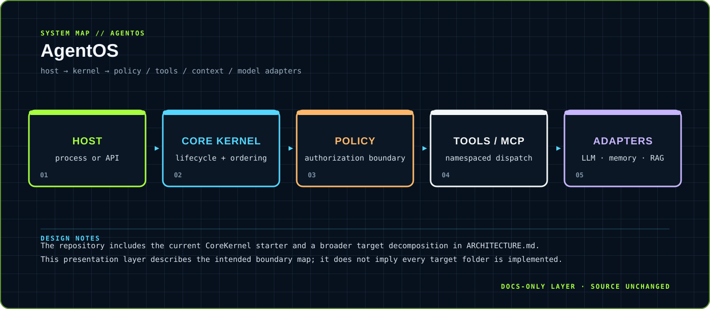

# AgentOS

> An LLM-neutral runtime kernel for ordered, authorized agent execution.

A production-oriented starter that keeps lifecycle, tool dispatch, context retrieval and authorization in the kernel while vendor behavior remains behind adapters.

`TypeScript · Node.js ≥ 20.11` &nbsp;·&nbsp; `CoreKernel + typed contracts + architecture reference`

## `01 / SYSTEM CARD`

- **Primary boundary:** `host → kernel → policy / tools / context / model adapters`
- **Documentation stance:** architecture and presentation only; application source is intentionally untouched.
- **Visual language:** Y2K terminal grid, brutalist labels, maximalist contrast, readable static SVG fallback.

## `02 / ARCHITECTURE`

The map above is a compact view of the repository's visible runtime boundary. It is designed to answer three questions quickly: where input enters, where policy or domain logic lives, and where external side effects leave the system.

## `03 / DESIGN NOTES`

- The repository includes the current CoreKernel starter and a broader target decomposition in ARCHITECTURE.md.
- This presentation layer describes the intended boundary map; it does not imply every target folder is implemented.

This upgrade adds documentation assets only. It does not change source files, dependency manifests, tests, workflows or runtime configuration.

## `04 / EXISTING PROJECT DOCUMENTATION`

`README.md` was not present before this upgrade. The repository's detailed architecture source of truth remains [`ARCHITECTURE.md`](ARCHITECTURE.md), including the target production decomposition and runtime sequence.

